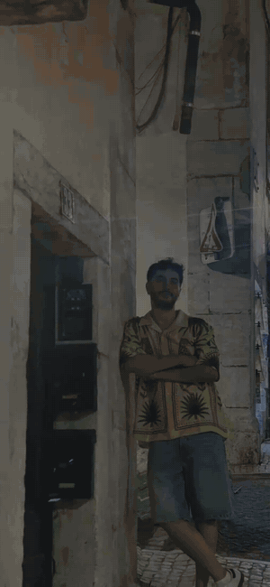
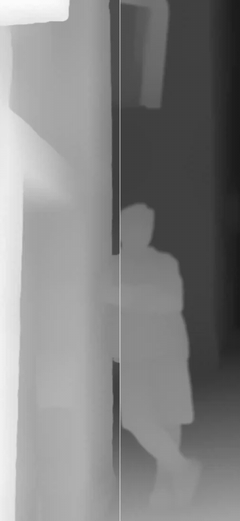
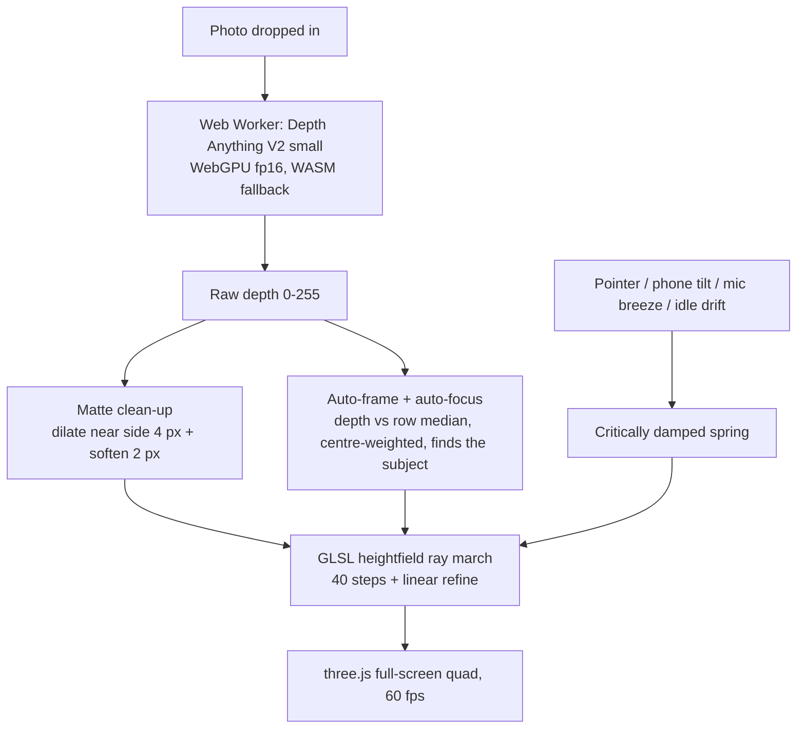
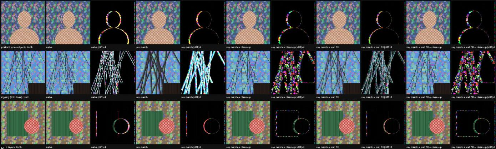

# SceneShift

**Any photo becomes a living 2.5D scene, right in the browser.** Drop a photo: a depth model runs locally
(WebGPU), and a GLSL shader moves the photo with your pointer, your phone's tilt, or the sound in the room.

<p>
  
  
  
</p>

*Left: the wallpaper (intro "bloom", then idle drift; auto-framed and auto-focused on the subject, so the street
moves around him). Middle: compare, naive offset left of the line, ray march + matte clean-up right. Right: depth
pass, raw left, cleaned matte right.*

> An outside experiment, inspired by the public case study of the interactive and generative Pixel wallpapers
> by Feels Like and Google ("transform your photos into cinematic scenes"). Not affiliated with either; I have
> only seen the public case page. Sample photo: me in Lisbon; the people in the far background are blurred.

## Why
The case study describes photos that gain a subtle perspective shift from depth analysis, synced with how you
hold the phone. I wanted to try that piece myself and learn where it breaks: depth edges. My background is
compositing, where edges are the whole job, so I treated the depth map like a key: clean the matte first, then
move the camera.

## How it works



| Step | What | File |
|---|---|---|
| Depth | Depth Anything V2 small via transformers.js in a Web Worker, WebGPU first | `src/workers/depth.worker.ts` |
| Matte clean-up | separable max filter + box blur on the depth, like dilate/soften on a key | `src/lib/depthPrep.ts` |
| Parallax | naive offset vs occlusion-aware heightfield ray march (+ optional wall fill) | `src/lib/shader.ts` |
| Motion | spring, DeviceOrientation tilt, mic RMS "breeze", idle drift, intro on `visibilitychange` | `src/lib/motion.ts` |
| App | Next.js client component, auto-framing + auto-focus, compare split, depth pass, phone frame | `src/components/SceneShift.tsx` |
| Eval | synthetic scenes with known depth, PSNR vs the true camera move | `src/components/Eval.tsx` |

The core idea in one line: for each screen pixel `s`, walk depth layers from near to far and take the first
source pixel `p = s - offset·(t - focus)` whose depth reaches `t`. Near things then cover far things, like a
real camera move, instead of the naive single read that doubles every edge.

## Eval
Real photos have no true depth, so `/eval` builds synthetic layered scenes where depth is known and the true
camera move can be drawn exactly. 3 scenes × 12 moves, PSNR in dB (whole frame / 12 px band around depth edges).

| Scene (true depth) | Naive | Ray march | Ray march + clean-up |
|---|---|---|---|
| portrait | 25.5 / 18.1 | 30.2 / 22.7 | **31.0 / 23.6** |
| thin lines ("rigging") | 14.9 / 12.7 | 15.6 / 13.3 | **22.5 / 20.2** |
| three layers | 26.8 / 20.4 | 30.8 / 24.4 | **31.9 / 25.6** |



- The ray march beats the naive offset by about **4 to 4.6 dB** when depth is good.
- The matte clean-up adds about 1 dB, and **+6.9 dB on thin lines**. The debug strip showed why: without it,
  every rope smears into a band as wide as the parallax shift (the heightfield "wall").
- A "wall fill" idea (look through depth walls, edge-extend the background) gave +1.5 dB alone but nothing on top
  of the clean-up, so it is off by default (`?fill=1`).
- With *model* depth on these flat synthetic images all methods are within 0.5 dB: there the depth model is the
  limit, and the numbers say nothing about real photos. Full table, speed and caveats: [`eval/RESULTS.md`](eval/RESULTS.md).

**Speed** (M2 Max, Chrome, 768 px): depth ~98 ms on WebGPU vs ~2.8 s on WASM; matte clean-up 27 ms; 60 fps render.

Honest limit: on real photos at strong offsets the revealed background is stretched, not invented, so a soft
halo can show beside edges. Real inpainting is the next step.

## Build log
How it was built, what broke and how each fault was isolated: [`BUILD_LOG.md`](BUILD_LOG.md).

## Where it could go
- Inpaint the revealed background once per photo (a "clean plate"), so strong moves have nothing to stretch.
- Score real photos: pairs taken with the phone moved a few cm give a true novel view to compare against.
- Adaptive step count for low-end phones; a native port of the shader is small (one fragment shader).
- Other inputs in the case study's spirit: time of day, weather, unfolding a foldable.

## Run it
```bash
npm install
npm run dev          # http://localhost:3000, eval at /eval
npm run build        # static export in out/ (BASE_PATH=/SceneShift for GitHub Pages)
```
Chrome or Edge with WebGPU for full speed (falls back to WASM). The model (a few tens of MB) downloads once from
Hugging Face and is cached by the browser. Query options: `?backend=wasm`, `?mode=0|1|2`, `?fill=1`,
`?frame=full`, `?ui=0`; press **H** to hide the panel.

Built by [Mert Barut](https://mertbarut.me) with Claude Code as a pair. MIT licence.
